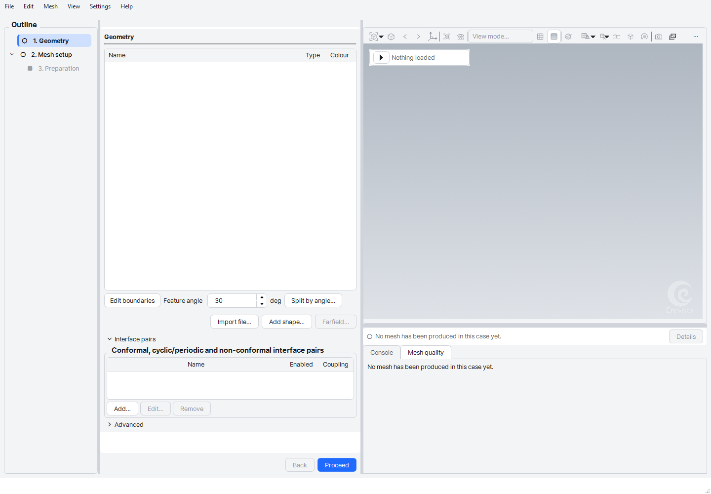

# Why FoamMesh

FoamMesh is a desktop mesher for OpenFOAM and for other solvers. It started from
NEXTfoam BaramMesh (GPL-3.0, credited in About) and has since been rebuilt around
one idea: pressing only the footer should give you a mesh worth running.

*The window on a finned heat sink opened from a STEP file: the outline lists the
steps, the viewport holds the model, and the page on the right asks only the
questions that step needs.*

## What you get

- **Two engines, one workflow.** snappyHexMesh (OpenFOAM v13) and Gmsh share
  import, repair, region seeds and Preparation. After that you choose the engine;
  the Gmsh route is a stand-alone mesher with its own controls and output formats.
- **A guided outline.** Each step shows whether it has run, what it produced and
  what is still needed. Proceed in the footer moves to the next step.
- **Checks you can read.** After a run, checkMesh findings are shown beside the
  numbers, and a mesh is only called passed when the check ran.
- **Region placement.** Drag a seed, adjust the domain box, and let voxel
  detection find the fluid region.
- **Crash resilience.** A case autosaves, and a restart offers to recover it.
- **No fixed cell limits.** Only memory limits the size of a mesh.

## What it is not

FoamMesh meshes. It does not set up or run the solver; export writes the mesh
and the files your solver reads.

## Where to go next

- [Getting started](getting_started.md)
- [Meshing with Gmsh](gmsh_workflow.md)
- [Export formats](export_formats.md)
